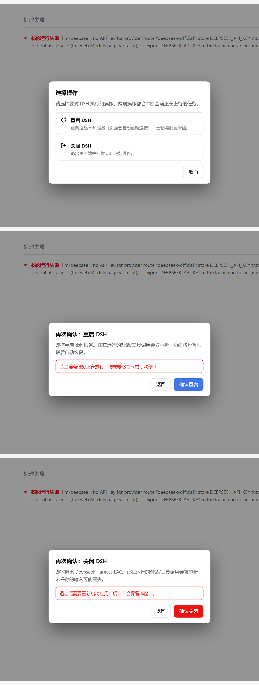

# dsh-powerbox

给 [DeepSeek Harness](https://github.com/deepseek-ai) 的 Web UI 加一个「电源」按钮：在会话页右上角点一下，就会弹出一个小窗口，让你选择 **重启 DSH** 还是 **关闭 DSH** —— 而且这两个操作**各自还要再确认一次**才会真的执行。

**[English →](README.md)**


两段式流程 —— 先选操作，再二次确认：



---

## 为什么做这个

平时想重启或退出 DSH，得去托盘图标或标题栏里翻菜单。窗口在前台、正在会话中时很不顺手。这个插件把两个动作放到你本来就在看的地方：会话页头部右侧。

因为这两个动作都是破坏性的 —— 重启会中断正在跑的工具调用，关闭会直接退出应用 —— 所以流程特意做成两步：

```
[⏻]  →  选择操作  →  重启 DSH / 关闭 DSH
                        ↓
                     二次确认  →  执行
```

`取消`、`Esc`、点击遮罩都不会触发任何操作。

## 环境要求

- 带 Web UI 的 DSH（`dsh --profile <名称>`），版本 0.2 及以上。
- 需要桌面壳提供 `window.dshDesktop` 桥。在普通浏览器里，按钮会渲染成**禁用态**并给出提示，而不是「看起来能点但点了没反应」。
  - 重启调用 `dshDesktop.boot.restart()`
  - 关闭调用 `dshDesktop._call('win.close-force', {})`

## 安装

```bash
dsh plugin --profile <你的 profile> add github:AsterLuo/dsh-powerbox
```

包里声明了 `dsh.bundle.patch`，所以官方 CLI 会自己把 `dsh-powerbox` 追加进 `dsh.profile.bundles`。**你不需要手动改 `cordis.patch.yml` 或 `package.json`。** 重启 DSH（或刷新页面）后，按钮就会出现在会话页头部。

如果你的 CLI 版本较老、不会自动协调 bundles，那就手动往 profile 的 `cordis.patch.yml` 里加这一行：

```yaml
- insert:
    - id: powerbox
      name: 'dsh-powerbox'
```

## 卸载

```bash
dsh plugin --profile <你的 profile> remove dsh-powerbox
```

如果你是手动加的那一行 patch，也一并删掉。之后重启 DSH。

## 实现说明

| 文件 | 作用 |
| --- | --- |
| `cordis.patch.yml` | 往组合后的 profile 里插入插件行（这是它能被加载的关键）。 |
| `lib/index.js` | host 半边。刻意做成空操作 —— 它只是为了让这个包成为合法的 bundle（loader 要求 `name` + `apply`）。 |
| `lib/client.js` | 其余全部：头部按钮、模式选择弹窗、两个确认弹窗、桥调用。 |

客户端半边往 `conversation.session.header.utilities` 这个插槽注册一个条目（`list` 类型、session 作用域 —— 和官方的「在应用中打开」用的是同一个），按钮就是这样被放到会话页头部最右侧的。

- **没有构建步骤**。它就是手写的 `window.__ModuleLoader__.load({ id, factory })` bundle，和内置插件的形式完全一致。
- **没有运行时依赖**。`react` 由宿主通过模块加载器提供。
- 样式只用 `--dsw-alias-*` 主题变量，所以亮色/暗色主题都能自动适配。

### 安全细节

- 请求在途时确认按钮会自动禁用；另外还有一道同步重入闸，即使有人用脚本派发点击，也不可能发出第二次调用。
- `Esc` 可以关闭弹窗 —— 但操作进行中除外，避免你把已经触发的重启「藏」起来。
- 弹窗关闭后焦点会回到电源按钮。
- 失败会在弹窗里显示原因并给出重试路径，绝不被静默吞掉。

## 开发

```bash
npm install
npm test        # node --test，基于 jsdom
npm run check   # 两半边的语法检查
```

测试在 jsdom 窗口里驱动**真实的插件 bundle**，用一个会记录调用的 `window.dshDesktop` 桩件替代桌面桥。`react` 被换成一个钩子语义兼容的极小实现（见 `test/harness.mjs`），因为真正的 react 由宿主在运行时提供、并不是本包的依赖。

覆盖范围：插槽注册契约、两个流程的完整点击链路、「二次确认前绝不发桥调用」、恰好只调用一次、在途禁用、`Esc`、遮罩、焦点归还、无桥降级、错误呈现，以及安装器依赖的包元数据与 patch 声明。

## 许可证

MIT © AsterLuo
